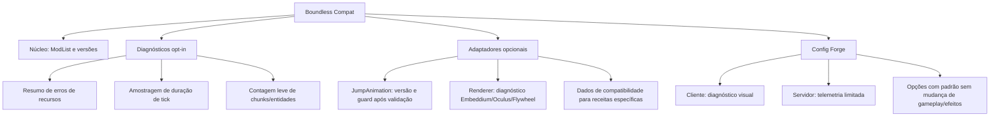

# Auditoria técnica estática — Boundless (Minecraft Forge 1.20.1)

**Data da auditoria:** 13/11/2026  
**Escopo:** instância atual, com foco nos arquivos recentes de `/logs`, inventário de `/mods`, configurações de `/config`, relatório de crash, opções do cliente e histórico local de mudanças.

## Resumo executivo

A instância carregou o mundo, mas a sessão mais recente terminou em um crash client-side confirmado no `JumpAnimation`. Durante a mesma sessão também houve atrasos severos do servidor integrado. Esses atrasos são reais; os arquivos disponíveis não permitem atribuí-los com segurança a um mod específico.

O inventário de runtime contém **425 JARs diretamente em `/mods`** e **491 IDs únicos na tabela de mods do Forge** (incluindo `forge`; alguns IDs são bibliotecas Jar-in-Jar). A tabela tem 514 linhas antes de consolidar IDs repetidos. A leitura recursiva de JARs externos e Jar-in-Jar encontrou **1.160 declarações de dependência** em manifestos `mods.toml` e `fabric.mod.json`. Não encontrei dependência obrigatória de outro mod carregado ausente por ID; `minecraft` e componentes do loader são tratados como ambiente, não como mods da tabela. As faixas de versão estão preservadas no CSV, mas não foram reavaliadas por um resolvedor semântico independente.

Os pontos de maior prioridade são:

1. **Crash confirmado:** NPE dentro de `JumpAnimationClient.isPlayerInSurvival()` ao ler `Minecraft.gameMode` nulo durante o callback do mod. O relatório registra um handler `mouseClicked`; a causa que deixou o contexto sem `gameMode` ainda precisa ser reproduzida.
2. **Travamentos confirmados:** nove mensagens `Can't keep up`, chegando a **111,641 s de atraso**, e watchdog do ModernFix registrando um tick de **40,091 s**. A única captura do thread do servidor estava dentro do tick de um villager, em `HurtBySensor`/`Brain`; isso é uma amostra de stack, não prova de causa-raiz.
3. **Integridade de conteúdo:** 47 receitas, 18 avanços, 13 funções, 5 modelos e 4 animações registraram erros de carregamento/parsing. São recursos específicos que podem faltar; não são, por si, prova de gargalo de desempenho.
4. **Configuração de shader desatualizada:** Oculus está configurado para `MakeUp-UltraFast-9.5g.zip`, mas esse arquivo foi atualizado para `MakeUp-UltraFast-9.6.zip` no histórico da instância e o log mais recente rejeitou o caminho antigo. Portanto, a sessão não comprova desempenho nem compatibilidade com shaders ativos.
5. **Integração com falha de injeção:** um Mixin do Forgified Fabric API relacionado a trades de villager falhou ao capturar uma variável local. O jogo prosseguiu; o impacto funcional não foi observado.

## Escopo e método

- `/mods`: enumerei os JARs externos, li os manifestos Forge e Fabric e percorri arquivos Jar-in-Jar em `META-INF/jars/`.
- `/logs`: priorizei `latest.log` e `modlist.txt`, ambos da sessão de 13/11/2026. Também consultei o relatório de crash mais recente, `stderr_stream.log`, o log compactado e `instance_audit.txt`.
- `/config` e raiz da instância: verifiquei as configurações ligadas a renderer, shaders, partículas, culling, IA, FPS, chunks e as opções de cliente relevantes.
- A análise de manifestos foi somente leitura; não extraí nem alterei JARs. Nenhum arquivo original foi modificado.
- Não executei build, jogo, benchmark ou teste de reprodução. Não há profiler de tick/frame, série temporal de heap/GC, contagens de entidades ou gravação de geração de chunks nos arquivos fornecidos.

### Contagens do inventário

| Medida | Resultado |
|---|---:|
| JARs externos em `/mods` | 425 |
| Arquivos JAR percorridos incluindo 116 Jar-in-Jar | 541 |
| IDs únicos na tabela runtime `modlist.txt` | 491 (inclui Forge) |
| Linhas de artefato na tabela runtime antes de consolidar | 514 |
| Manifestos `META-INF/mods.toml` / declarações internas de mods | 481 / 482 |
| Manifestos `fabric.mod.json` / IDs declarados | 48 / 48 |
| Relações de dependência exportadas | 1.160 |
| Dependências obrigatórias de outros mods carregados ausentes por ID | 0 |

O inventário completo está em [inventario_mods.csv](inventario_mods.csv), com IDs, nomes, versões informadas pelo loader, artefatos e referências a bibliotecas incorporadas. As declarações de dependência, faixas, lado e origem estão em [dependencias_mods.csv](dependencias_mods.csv). O inventário runtime registra o que o loader efetivamente listou; dependências como Minecraft/Forge pertencem ao ambiente e não aparecem como IDs de mods normais.

## Achados confirmados

### 1. Crash client-side no JumpAnimation — impacto alto, risco alto

O crash report `crash-reports/crash-2026-11-13_09.58.24-client.txt` aponta `Description: mouseClicked event handler` e uma `NullPointerException`: `JumpAnimationClient.isPlayerInSurvival()` acessa `Minecraft.gameMode` quando o campo está nulo. A chamada vem de `JumpAnimationClient.onKeyInput()`. O mesmo erro aparece no fim do `latest.log`.

O JAR instalado é `jumpanimation-2.0.0-1.20.1.jar`, e o manifesto declara suporte a Minecraft 1.20.1/Forge; a versão de arquivo 1.20.1 também aparece no [catálogo oficial de arquivos do projeto](https://www.curseforge.com/minecraft/mc-mods/jumpanimation/files/all?page=1&pageSize=20&showAlphaFiles=hide&version=1.20.1). Não há evidência de que Oculus/Embeddium tenha causado esse NPE. O gatilho exato permanece em aberto e deve ser reproduzido antes de escolher um workaround.

### 2. Atrasos do servidor integrado — evento confirmado, origem não atribuída

No `latest.log`, entre 09:51 e 09:57, aparecem **nove** avisos `Can't keep up`: 3,910 ms, 111,641 ms, 43,975 ms, 7,352 ms, 17,508 ms, 6,734 ms, 13,740 ms, 6,097 ms e 32,830 ms. O watchdog do ModernFix registrou um tick de 40,091 ms às 09:52:34. O tempo total reportado para abrir o jogo e o mundo foi 300,42 s; o datapack reload inicial levou 33,84 s.

A captura do thread do servidor mostra o caminho `Villager.tick → Brain → HurtBySensor`. Não há contagem de villagers, perfil de CPU por método ou comparação controlada. Isso **não confirma** que villager AI, `AI-Improvements`, `EnhancedAI`, densidade de entidades ou geração de mundo seja a causa.

### 3. Falhas de conteúdo — impacto localizado, corrigibilidade potencialmente alta

O carregamento reportou 47 receitas inválidas, 18 avanços, 13 funções, 5 modelos, 4 animações, 16 loot tables e 2 tags com erro. Entre os exemplos de receitas há ingredientes em formato incompatível, itens opcionais ausentes (por exemplo, Galosphere/NetherExp/Warhammers) e recursos de integração EveryCompat/Valhelsia Furniture. As falhas significam que esses recursos específicos podem não ser registrados ou exibidos; ainda não foi feito um mapeamento de cada entrada para a funcionalidade percebida no jogo.

Também há duas falhas de transformação do coremod `field_to_method.js` na função `biome`, 15 diagnósticos de configuração Mixin sem `minVersion`, além de avisos/erros secundários de asset. O jogo, apesar disso, chegou ao menu e abriu um mundo. A lista completa dos detalhes continua nos logs originais.

### 4. Configuração do Oculus aponta para shaderpack inexistente

`config/oculus.properties` tem `enableShaders=true` e `shaderPack=MakeUp-UltraFast-9.5g.zip`. O histórico local `logs/instance_audit.txt` registra a substituição do arquivo por `MakeUp-UltraFast-9.6.zip`; o `/logs/latest.log` diz que o nome antigo não é válido e que não pode carregá-lo. Assim, o renderer recuou sem aquele shader. É uma divergência de configuração confirmada, não evidência de bug de shader na sessão.

### 5. Falha de injeção em trades de villager — erro confirmado, impacto não medido

O `latest.log:7981` registra falha de captura de variável local no Mixin `TradeOffersTypeAwareBuyForOneEmeraldFactoryMixin`, de `fabric-object-builder-api-v1`, durante transformação de `VillagerTrades`. O jogo continuou. O [issue #4456 do Fabric API](https://github.com/FabricMC/fabric-api/issues/4456) documenta um problema do mesmo caminho de trades na linha 1.20.1. A semelhança sustenta uma suspeita de incompatibilidade; não confirma que uma oferta específica esteja errada nesta instância.

## Suspeitas fundamentadas e matriz resumida

Os detalhes por combinação, impacto, risco, viabilidade, evidência e próximo passo estão em [matriz_compatibilidade.csv](matriz_compatibilidade.csv).

| Combinação/área | Classificação | Impacto / risco | Viabilidade agora |
|---|---|---|---|
| JumpAnimation e contexto de input/menu | NPE confirmado no mod; gatilho por reproduzir | Alto / alto | Média; procurar correção upstream primeiro |
| Forgified Fabric API e `VillagerTrades` | Falha de injeção confirmada; efeito não observado | Médio / médio | Média; validar efeito antes de patch |
| Embeddium e Sodium Dynamic Lights | Risco fundamentado pela configuração local e issue upstream | Médio / médio | Alta para diagnóstico de configuração |
| Create/Flywheel/Oculus/Embeddium | Fallback local confirmado; compatibilidade shader é suspeita | Médio com shader / médio-alto | Baixa até testar com pack válido |
| FPS Reducer e Dynamic FPS | Sobreposição provável; não é conflito demonstrado | Baixo / baixo | Alta para comparar políticas/configurações |
| Recursos de receita/avanço/modelo/função | Falhas específicas confirmadas | Baixo-médio / médio | Alta para correções por recurso |
| Tectonic/TerraBlender/BOP/Terralith | Compatibilidade documentada; conflito local não encontrado | Baixo / baixo-médio | Alta para acompanhar versões/notas |
| Entidades cosméticas com EntityCulling | Possível efeito visual localizado, não observado | Baixo-médio / baixo-médio | Alta se houver sintoma visual |

### Observações da pesquisa online

- O [issue #46 do Sodium Dynamic Lights](https://github.com/txnimc/SodiumDynamicLights/issues/46) relata interação com a opção do Embeddium “Animate Only Visible Textures”. A configuração local está `true`; não há relato local de luz dinâmica incorreta, portanto é risco para verificar, não defeito confirmado.
- O [issue #10327 do Create](https://github.com/Creators-of-Create/Create/issues/10327) discute sintomas de shader em uma combinação antiga de Create/Flywheel, Embeddium e Oculus. O stack local tem essas famílias e o Flywheel fez fallback, mas o shader configurado não carregou. O relato upstream é evidência de risco contextual, não reprodução local.
- A [documentação do Tectonic](https://modrinth.com/datapack/tectonic?dep=1) declara compatibilidade com mods de bioma via TerraBlender, incluindo Biomes O’ Plenty e Terralith. Isso reduz a justificativa para classificar a combinação como conflito por si só; não comprova compatibilidade de todos os mods de estruturas presentes.
- A documentação do [EntityCulling](https://github.com/tr7zw/entityculling) descreve culling client-side, sem alterar a simulação do servidor; entidades com animações/cutscenes podem exigir whitelist em casos de ocultação incorreta. A configuração local já contém uma whitelist extensa.
- [FPS Reducer](https://www.curseforge.com/minecraft/mc-mods/fps-reducer) e [Dynamic FPS](https://github.com/juliand665/Dynamic-FPS/blob/main/README.md) cobrem estados de janela/menu/ociosidade em parte sobrepostos. A sobreposição é funcional; não há evidência de conflito nem necessidade de remover um.

## Análise de renderização, partículas, chunks e memória

### Renderer e efeitos

`config/embeddium-options.json` habilita culling de entidades, oclusão de fog e block-face culling, atualizações assíncronas de chunks e animação somente de texturas visíveis; weather/leaves estão em `FANCY`, o limite de render-ahead é 3 e threads de chunk builder estão em automático. Essas opções mostram recursos de otimização ativos, mas não informam FPS ou custo real.

`options.txt` usa render distance 7, simulation distance 8 e partículas `ALL`. Particle Rain aceita até 1.500 partículas, tem densidade 50 e densidade de tempestade 167; os efeitos listados do Particular estão habilitados. Isso cria uma **oportunidade de medir cenas densas**, especialmente com chuva, partículas de combate e shader, sem demonstrar que a GPU está saturada. A RX 480 tem 4.095 MB de VRAM; essa especificação isolada não prova limitação.

### Animações, entidades e IA

O stack do watchdog passou por um villager no caminho vanilla de sensor/brain. `AI-Improvements` mantém as opções de remoção de goals consultadas em `false` e substitui o cálculo do look controller vanilla em casos compatíveis; `EnhancedAI` também está instalado. Sem contagens por entidade e perfil de tick, não se pode atribuir o atraso a esses mods. `EntityCulling` é uma configuração de cliente e não explica o atraso do servidor integrado.

### Chunk loading e geração do mundo

O conjunto inclui várias camadas de biome/worldgen (Tectonic, Terralith, Biomes O’ Plenty/TerraBlender, Nether datapacks/mods) e muitos geradores de estruturas. A complexidade torna geração de chunks uma área válida de medição; não há perfil de geração nos arquivos. O datapack reload de 33,84 s e o world open de 300,42 s são tempos confirmados, mas não isolam geração. Configs de carregamento antecipado/assíncrono podem alterar a quantidade de chunks processados ou retidos; o efeito em TPS/memória ainda não foi medido.

### Memória

O crash report descreve Java 17.0.15, CPU Intel i5-6600 de 4 threads, Radeon RX 480 com 4 GB de VRAM e heap JVM máximo de 4 GB (`-Xmx4096m`). O crash registrado é uma NPE, não um `OutOfMemoryError`. ModernFix, FerriteCore e MemoryLeakFix estão instalados, mas a configuração/log disponível não demonstra redundância prejudicial entre eles. Não há série de heap, GC, paginação ou memória nativa; **não há base para diagnosticar falta de memória**, apesar do tamanho do pack e do heap configurado.

## Proposta arquitetural para o mod exclusivo

Nome de trabalho: **Boundless Compat**. A primeira versão deve ser um mod diagnóstico/compatibilidade com comportamento passivo por padrão, módulos independentes e dependências opcionais detectadas em runtime. A arquitetura usa eventos e configurações Forge para funcionalidade própria; uma correção que toca internals de outro mod só entra depois de reproduzida e versionada.

### Diretrizes por módulo

1. **Núcleo passivo:** usar `ModList` para detectar mod e versão; não declarar dependência obrigatória de Create, Embeddium, Oculus, JumpAnimation ou Fabric API. Registrar aviso legível em vez de alterar configurações do usuário.
2. **Diagnóstico opt-in:** usar `ServerTickEvent` para amostrar durações e estatísticas agregadas em janela limitada. Contar mudanças por `EntityJoinLevelEvent`/eventos de chunk apenas se a amostragem estiver habilitada; não percorrer todo o mundo a cada tick. Para tempos reais de frame/GPU e atribuição por método, usar um profiler em uma etapa de medição, não inferir do evento render.
3. **Módulo de renderer:** validar presença, versão e configuração de Embeddium/Oculus/Flywheel/Dynamic Lights e emitir diagnóstico. Não desativar partículas, animações, shaders ou qualidade visual automaticamente.
4. **JumpAnimation:** primeiro confirmar se há versão corrigida e reproduzir a condição do `gameMode == null`. Forge recomenda consumo de key mappings próprios em `ClientTickEvent`, e eventos só podem ser cancelados se forem canceláveis; isso não cria automaticamente um interceptador seguro para um listener privado de outro mod. Priorizar correção upstream/configuração. Um Mixin condicional, restrito a uma versão e com verificação de alvo, seria último recurso, somente se nenhuma API/evento cobrir o caso.
5. **Recursos de datapack:** reparar receitas/avanços somente após confirmar as entradas desejadas e condições de dependência. Para recursos declarativos, KubeJS/datapack de compatibilidade pode ser menor e mais rastreável do que um Mixin; não registrar substitutos que mudem mecânicas sem autorização.
6. **Configuração e reversão:** `ForgeConfigSpec` com opções independentes, defaults equivalentes ao pack atual e logs explicando cada ativação. Nenhuma ação automática sobre arquivos em `/mods` ou configurações originais.

A documentação Forge de [eventos e cancelamento](https://docs.minecraftforge.net/en/1.20.1/concepts/events/) exige verificar se um evento é cancelável; a documentação de [key mappings 1.20.1](https://docs.minecraftforge.net/en/1.20.1/misc/keymappings/) recomenda `ClientTickEvent`/`consumeClick` para key mappings pertencentes ao próprio mod e não tratar `InputEvent` como substituto geral.

### Sequência de trabalho sugerida após aprovação

1. Reproduzir o crash do JumpAnimation e confirmar se a configuração do Oculus deve apontar para 9.6.
2. Medir tick e geração em um cenário fixo, registrando contagem de entidades, chunks carregados e GC; incluir perfil client-side para partículas/animações/render.
3. Corrigir primeiro conteúdo de datapack/receita isolado e revalidar os itens/recursos afetados.
4. Só então selecionar integrações para a primeira versão do mod; cada otimização deve ser opcional e manter os efeitos atuais por padrão.

## Artefatos desta auditoria

- [Relatório principal](AUDITORIA.md)
- [Inventário consolidado (491 IDs)](inventario_mods.csv)
- [Dependências declaradas (1.160 relações)](dependencias_mods.csv)
- [Matriz de compatibilidade detalhada](matriz_compatibilidade.csv)

## Limitações

Esta é uma auditoria estática de uma instância e uma sessão recente, não um benchmark nem teste A/B. Uma única stack de thread é uma amostra, e mensagem `ERROR` pode ser não fatal. Compatibilidade documentada online foi tratada como contexto, não como prova de comportamento local. Nenhuma recomendação desta etapa altera o pack; implementação depende de aprovação.
